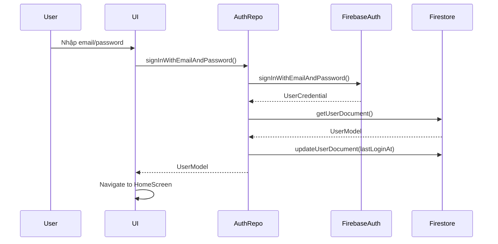
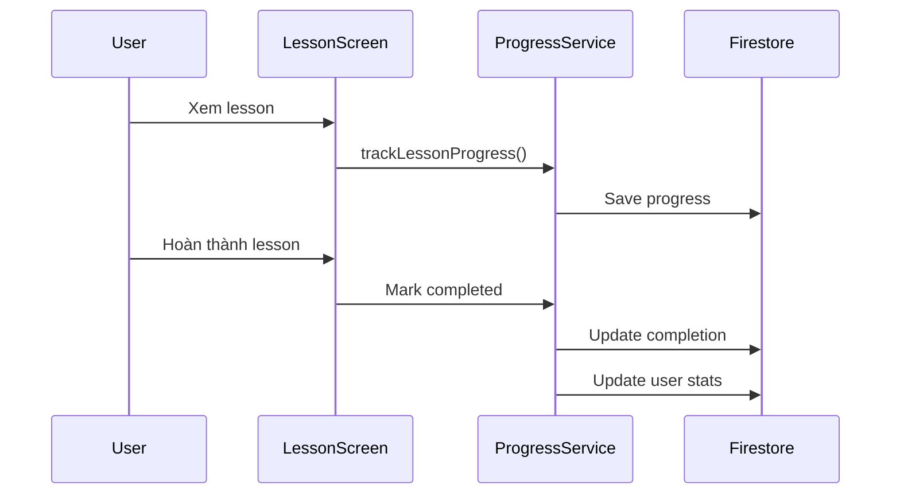
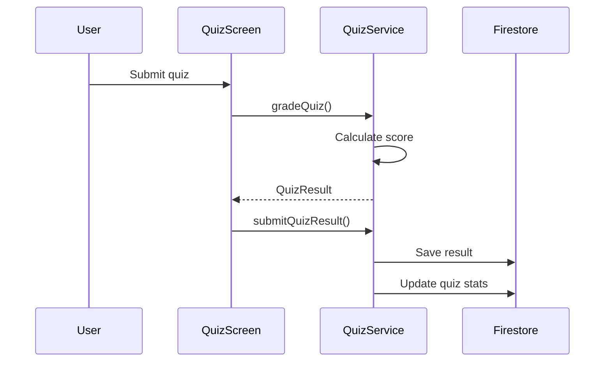
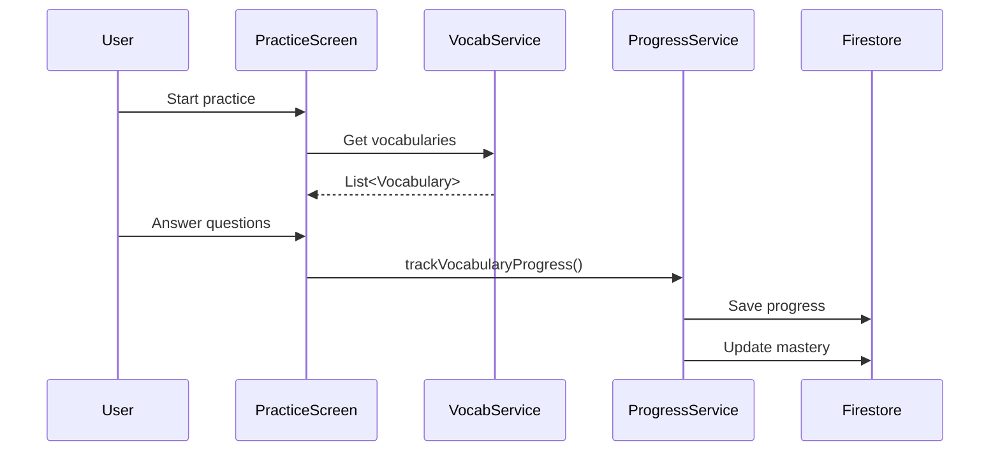

# 📚 Tài liệu Hướng dẫn Toàn diện về Modzy English App

> Tài liệu này cung cấp hướng dẫn chi tiết về cấu trúc, kiến trúc, các chức năng chính, thuật toán và cách hoạt động của ứng dụng Modzy English để phục vụ báo cáo tốt nghiệp.

---

## 📋 Mục lục

1. [Tổng quan về App](#1-tổng-quan-về-app)
2. [Kiến trúc và Cấu trúc thư mục](#2-kiến-trúc-và-cấu-trúc-thư-mục)
3. [Công nghệ và Dependencies](#3-công-nghệ-và-dependencies)
4. [Cấu trúc Database](#4-cấu-trúc-database)
5. [Authentication và Authorization](#5-authentication-và-authorization)
6. [Các chức năng chính](#6-các-chức-năng-chính)
7. [Thuật toán quan trọng](#7-thuật-toán-quan-trọng)
8. [Widget và UI Components](#8-widget-và-ui-components)
9. [State Management](#9-state-management)
10. [Services và Repositories](#10-services-và-repositories)
11. [Data Flow Diagrams](#11-data-flow-diagrams)
12. [Best Practices](#12-best-practices)

---

## 1. Tổng quan về App

### 1.1. Giới thiệu Modzy English

**Modzy English** là một ứng dụng học tiếng Anh được xây dựng bằng Flutter, tích hợp với Firebase để cung cấp trải nghiệm học tập toàn diện. Ứng dụng hỗ trợ nhiều phương thức học tập khác nhau bao gồm bài học, từ vựng, quiz, mini games và thách đấu với bạn bè.

### 1.2. Mục đích và Phạm vi

**Mục đích:**
- Cung cấp nền tảng học tiếng Anh hiện đại, tương tác và hiệu quả
- Theo dõi tiến độ học tập chi tiết của người dùng
- Tạo môi trường học tập gamified với điểm số, xếp hạng và thách đấu
- Hỗ trợ quản lý nội dung cho giáo viên và quản trị viên

**Phạm vi:**
- Học bài học với video, audio và nội dung text
- Luyện tập từ vựng với nhiều chế độ (flashcard, trắc nghiệm, điền từ, nghe)
- Làm quiz để kiểm tra kiến thức
- Chơi mini games để học từ vựng một cách vui nhộn
- Thách đấu bạn bè trong các cuộc thi
- Quản lý người dùng và nội dung (dành cho admin/teacher)

### 1.3. Các tính năng chính

#### Tính năng cho Người dùng thường:
1. **Đăng ký/Đăng nhập**: Xác thực qua Firebase Auth
2. **Hồ sơ cá nhân**: Quản lý thông tin, ảnh đại diện
3. **Bài học (Lessons)**: Học với video, audio, text
4. **Từ vựng (Vocabulary)**: Học và luyện tập từ vựng
5. **Quiz**: Làm bài kiểm tra kiến thức
6. **Mini Games**: Chơi game học từ vựng (Word Match, Word Scramble, Word Search)
7. **Thách đấu (Challenges)**: Thách đấu bạn bè
8. **Bảng xếp hạng (Leaderboard)**: Xem xếp hạng người dùng
9. **Lịch sử học tập**: Theo dõi tiến độ
10. **Yêu thích (Favorites)**: Lưu bài học, từ vựng yêu thích

#### Tính năng cho Giáo viên (Teacher):
1. **Teacher Dashboard**: Quản lý bài học, từ vựng
2. **Tạo nội dung**: Tạo bài học, từ vựng, quiz
3. **Quản lý media**: Upload video, audio, hình ảnh

#### Tính năng cho Quản trị viên (Admin):
1. **Admin Dashboard**: Quản lý toàn bộ hệ thống
2. **Quản lý người dùng**: Xem, chỉnh sửa, vô hiệu hóa tài khoản
3. **Quản lý nội dung**: Quản lý bài học, từ vựng, quiz, games
4. **Analytics**: Thống kê và phân tích dữ liệu
5. **Quản lý thách đấu**: Tạo và quản lý challenge exercises

### 1.4. Platform hỗ trợ

- ✅ **Android**: Hỗ trợ đầy đủ
- ✅ **iOS**: Hỗ trợ đầy đủ
- ✅ **Web**: Hỗ trợ đầy đủ
- ✅ **Windows**: Hỗ trợ đầy đủ
- ✅ **macOS**: Hỗ trợ đầy đủ
- ✅ **Linux**: Hỗ trợ đầy đủ

---

## 2. Kiến trúc và Cấu trúc thư mục

### 2.1. Cấu trúc thư mục chi tiết

```
modzy_english/
├── lib/
│   ├── core/                    # Core functionality
│   │   ├── constants/           # Constants (colors, templates)
│   │   ├── services/            # Business logic services
│   │   ├── utils/               # Utility functions
│   │   └── widgets/             # Reusable widgets
│   ├── features/                # Feature modules
│   │   ├── admin/               # Admin features
│   │   ├── auth/                # Authentication
│   │   ├── home/                # Home screen
│   │   ├── lessons/             # Lesson features
│   │   ├── vocabulary/          # Vocabulary features
│   │   ├── quiz/                # Quiz features
│   │   ├── mini_games/          # Mini games
│   │   ├── profile/             # User profile
│   │   ├── leaderboard/        # Leaderboard
│   │   ├── social/             # Social features (challenges)
│   │   ├── teacher/            # Teacher features
│   │   └── videos/             # Video features
│   ├── models/                  # Data models
│   ├── routes/                  # Navigation routes
│   └── main.dart               # App entry point
├── assets/                      # Static assets
├── android/                     # Android configuration
├── ios/                        # iOS configuration
└── pubspec.yaml                # Dependencies
```

### 2.2. Kiến trúc tổng thể

App sử dụng **Clean Architecture** với các lớp:

```
┌─────────────────────────────────────┐
│         Presentation Layer          │
│  (Screens, Widgets, State Mgmt)    │
└──────────────┬──────────────────────┘
               │
┌──────────────▼──────────────────────┐
│         Business Logic Layer        │
│      (Services, Repositories)       │
└──────────────┬──────────────────────┘
               │
┌──────────────▼──────────────────────┐
│          Data Layer                 │
│   (Firebase, Models, Storage)       │
└─────────────────────────────────────┘
```

**Giải thích:**
- **Presentation Layer**: UI, widgets, screens, state management (Riverpod)
- **Business Logic Layer**: Services xử lý logic nghiệp vụ
- **Data Layer**: Firebase (Auth, Firestore, Storage), Models

### 2.3. Separation of Concerns

**Core (`lib/core/`):**
- `constants/`: Định nghĩa màu sắc, templates
- `services/`: Logic nghiệp vụ (Firebase, Vocabulary, Quiz, etc.)
- `utils/`: Hàm tiện ích (validators, helpers)
- `widgets/`: Widget tái sử dụng (CustomButton, CustomTextField)

**Features (`lib/features/`):**
- Mỗi feature là một module độc lập
- Mỗi feature có: `screens/`, `widgets/`, `data/` (nếu cần)
- Tách biệt rõ ràng giữa các tính năng

**Models (`lib/models/`):**
- Định nghĩa cấu trúc dữ liệu
- Chuyển đổi giữa Firestore và Dart objects

### 2.4. Mô hình MVC/MVVM

App sử dụng mô hình **MVVM** (Model-View-ViewModel):

- **Model**: Các class trong `lib/models/` (UserModel, LessonModel, etc.)
- **View**: Các screen và widget trong `lib/features/`
- **ViewModel**: Các service trong `lib/core/services/` xử lý logic

**Ví dụ flow:**
```
Screen (View) 
  → Service (ViewModel) 
    → Firebase (Model/Data)
      → Service xử lý
        → Cập nhật UI
```

---

## 3. Công nghệ và Dependencies

### 3.1. Flutter Framework

**Flutter** là framework chính để xây dựng ứng dụng:
- **Version**: SDK ^3.8.1
- **Ngôn ngữ**: Dart
- **UI**: Material Design 3
- **Hot Reload**: Hỗ trợ phát triển nhanh

**Ưu điểm:**
- Cross-platform: Một codebase cho tất cả platforms
- Performance cao với Dart compiler
- Rich widget library
- Hot reload để phát triển nhanh

### 3.2. Firebase Services

#### 3.2.1. Firebase Core
```yaml
firebase_core: ^3.6.0
```
- Khởi tạo Firebase trong app
- Quản lý cấu hình cho từng platform

#### 3.2.2. Firebase Authentication
```yaml
firebase_auth: ^5.3.1
```
**Chức năng:**
- Đăng ký/Đăng nhập với email/password
- Quản lý session
- Password reset
- Email verification

**Sử dụng:**
```dart
// Đăng nhập
FirebaseAuth.instance.signInWithEmailAndPassword(
  email: email,
  password: password,
);

// Lắng nghe thay đổi trạng thái đăng nhập
FirebaseAuth.instance.authStateChanges();
```

#### 3.2.3. Cloud Firestore
```yaml
cloud_firestore: ^5.4.3
```
**Chức năng:**
- Database NoSQL real-time
- Lưu trữ users, lessons, vocabulary, quiz, etc.
- Real-time updates với streams
- Queries phức tạp

**Cấu trúc:**
```
users/{userId}
  ├── lesson_progress/{lessonId}
  ├── vocabulary_progress/{vocabId}
  ├── general_progress/{progressId}
  └── ...
lessons/{lessonId}
vocabulary/{vocabId}
quizzes/{quizId}
```

#### 3.2.4. Firebase Storage
```yaml
firebase_storage: ^12.3.2
```
**Chức năng:**
- Lưu trữ file (images, videos, audio)
- Upload/Download files
- Quản lý permissions

### 3.3. State Management - Riverpod

```yaml
flutter_riverpod: ^2.5.1
```

**Riverpod** là state management solution:
- **Provider**: Quản lý state và dependencies
- **ConsumerWidget**: Widget lắng nghe state changes
- **StateProvider**: Quản lý state đơn giản
- **FutureProvider**: Quản lý async data

**Ví dụ sử dụng:**
```dart
// Định nghĩa provider
final userProvider = StateProvider<UserModel?>((ref) => null);

// Sử dụng trong widget
class MyWidget extends ConsumerWidget {
  @override
  Widget build(BuildContext context, WidgetRef ref) {
    final user = ref.watch(userProvider);
    return Text(user?.displayName ?? 'Guest');
  }
}
```

**Ưu điểm:**
- Type-safe
- Compile-time errors
- Dễ test
- Dependency injection

### 3.4. Navigation - GoRouter

```yaml
go_router: ^14.2.7
```

**GoRouter** quản lý navigation:
- Declarative routing
- Deep linking
- Route guards
- Nested navigation

**Cấu hình:**
```dart
final router = GoRouter(
  routes: [
    GoRoute(path: '/', builder: (context, state) => HomeScreen()),
    GoRoute(path: '/login', builder: (context, state) => LoginScreen()),
  ],
);
```

### 3.5. HTTP & API

#### HTTP Client
```yaml
http: ^1.4.0
dio: ^5.7.0
```

**Sử dụng:**
- `http`: HTTP requests đơn giản
- `dio`: HTTP client mạnh mẽ với interceptors, error handling

#### Crypto
```yaml
crypto: ^3.0.3
```
- Hash functions
- Encryption/Decryption

### 3.6. UI Components

#### Image Handling
```yaml
cached_network_image: ^3.4.1
image_picker: ^1.1.2
```

**Chức năng:**
- `cached_network_image`: Cache và hiển thị ảnh từ URL
- `image_picker`: Chọn ảnh từ gallery/camera

#### Video/Audio
```yaml
video_player: ^2.9.1
audioplayers: ^6.5.0
chewie: ^1.7.4
```

**Chức năng:**
- `video_player`: Phát video
- `audioplayers`: Phát audio
- `chewie`: Video player UI wrapper

#### Loading & Animations
```yaml
loading_animation_widget: ^1.2.1
shimmer: ^3.0.0
```

**Chức năng:**
- Loading animations
- Shimmer effects cho skeleton loading

### 3.7. Local Storage

```yaml
shared_preferences: ^2.3.2
```

**Chức năng:**
- Lưu preferences (theme, language, etc.)
- Remember me functionality
- Cache settings

### 3.8. Media Management

#### Cloudinary
```yaml
cloudinary_url_gen: ^1.0.0
cloudinary_api: ^1.0.0
```

**Chức năng:**
- Upload images/videos lên Cloudinary
- Transform media (resize, crop, etc.)
- CDN delivery

### 3.9. Charts & Visualization

```yaml
fl_chart: ^0.69.0
```

**Chức năng:**
- Vẽ biểu đồ (line, bar, pie)
- Hiển thị thống kê
- Progress charts

### 3.10. Utilities

```yaml
fluttertoast: ^8.2.8    # Toast messages
intl: ^0.19.0            # Internationalization
url_launcher: ^6.3.1     # Open URLs
path: ^1.9.0             # Path manipulation
file_picker: ^8.1.3      # File selection
flutter_dotenv: ^5.2.1   # Environment variables
```

### 3.11. Tổng kết Dependencies

**Nhóm chính:**
1. **Core**: Flutter SDK
2. **Backend**: Firebase (Auth, Firestore, Storage)
3. **State**: Riverpod
4. **Navigation**: GoRouter
5. **UI**: Material Design, custom widgets
6. **Media**: Video player, audio player, image handling
7. **Storage**: SharedPreferences, Cloudinary
8. **Utilities**: HTTP, crypto, charts, etc.

**Tổng số dependencies**: ~30 packages

---

## 4. Cấu trúc Database

### 4.1. Tổng quan

App sử dụng **Firebase Firestore** - NoSQL document database:
- **12 collections chính**
- **8 subcollections** dưới `users`
- **Real-time updates** với streams
- **Queries phức tạp** với indexes

### 4.2. Collections chính

#### 4.2.1. Collection: `users`

**Mục đích**: Lưu trữ thông tin người dùng

**Cấu trúc:**
```dart
{
  uid: String,                    // Document ID = Firebase Auth UID
  email: String,
  displayName: String,
  profileImageUrl: String?,
  role: String,                  // 'user', 'teacher', 'admin'
  createdAt: Timestamp,
  lastLoginAt: Timestamp?,
  isActive: Boolean,
  preferences: Map<String, dynamic>,
  totalLessonsCompleted: Integer,
  totalVocabularyLearned: Integer,
  currentLevel: Integer,          // 1-5 (Beginner → Advanced)
  progressPercentage: Double,     // 0.0 - 100.0
  friends: Array<String>,         // List of friend UIDs
}
```

**Subcollections:**
1. `users/{userId}/favorites` - Mục yêu thích
2. `users/{userId}/bookmarks` - Từ vựng đánh dấu
3. `users/{userId}/lesson_progress` - Tiến độ bài học
4. `users/{userId}/vocabulary_progress` - Tiến độ từ vựng
5. `users/{userId}/general_progress` - Tiến độ tổng quát
6. `users/{userId}/lesson_media_progress` - Tiến độ media
7. `users/{userId}/vocabulary_mastery` - Mức độ thành thạo từ vựng

#### 4.2.2. Collection: `lessons`

**Mục đích**: Lưu trữ bài học

**Cấu trúc:**
```dart
{
  title: String,
  description: String,
  content: String,                // HTML/Markdown
  category: String,
  difficultyLevel: Integer,      // 1-5
  estimatedDuration: Integer,     // minutes
  tags: Array<String>,
  objectives: Array<String>,
  audioUrl: String?,
  imageUrl: String?,
  videoUrl: String?,
  sections: Array<LessonSection>,
  vocabulary: Array<String>,      // Vocabulary IDs
  createdAt: Timestamp,
  updatedAt: Timestamp?,
  isActive: Boolean,
  isPremium: Boolean,
  order: Integer,
  createdBy: String,             // User ID (teacher/admin)
  metadata: Map<String, dynamic>,
}
```

**LessonSection:**
```dart
{
  title: String,
  content: String,
  type: String,                   // 'text', 'audio', 'video', 'exercise'
  mediaUrl: String?,
  metadata: Map<String, dynamic>,
}
```

#### 4.2.3. Collection: `vocabulary`

**Mục đích**: Lưu trữ từ vựng

**Cấu trúc:**
```dart
{
  word: String,
  pronunciation: String,
  meaning: String,               // Nghĩa tiếng Việt
  definition: String?,            // Định nghĩa tiếng Anh
  examples: Array<String>,
  imageUrl: String?,
  audioUrl: String?,
  category: String,
  difficultyLevel: Integer,      // 1-5
  synonyms: Array<String>,
  antonyms: Array<String>,
  partOfSpeech: String,          // 'noun', 'verb', etc.
  lessonIds: Array<String>,     // Lessons containing this word
  createdAt: Timestamp,
  updatedAt: Timestamp?,
  isActive: Boolean,
  usageCount: Integer,
  createdBy: String,
  metadata: Map<String, dynamic>,
}
```

#### 4.2.4. Collection: `quizzes`

**Mục đích**: Lưu trữ bài quiz

**Cấu trúc:**
```dart
{
  title: String,
  description: String,
  lessonId: String?,             // Associated lesson
  questions: Array<QuizQuestion>,
  timeLimit: Integer,             // minutes, 0 = unlimited
  passingScore: Integer,          // percentage, default 70
  isActive: Boolean,
  category: String,
  difficultyLevel: Integer,      // 1-5
  createdAt: Timestamp,
  updatedAt: Timestamp?,
  createdBy: String,
  metadata: Map<String, dynamic>,
}
```

**QuizQuestion:**
```dart
{
  id: String,
  question: String,
  type: String,                  // 'multipleChoice', 'multipleSelect', 
                                 // 'trueFalse', 'fillInBlank', etc.
  options: Array<String>,        // For multiple choice
  correctAnswer: String,         // Single answer
  correctAnswers: Array<String>, // Multiple answers
  explanation: String?,
  imageUrl: String?,
  audioUrl: String?,
  points: Integer,
  metadata: Map<String, dynamic>,
}
```

#### 4.2.5. Collection: `quiz_results`

**Mục đích**: Lưu trữ kết quả làm quiz

**Cấu trúc:**
```dart
{
  quizId: String,
  userId: String,
  answers: Array<QuizAnswer>,
  score: Integer,
  totalPoints: Integer,
  percentage: Double,            // 0.0 - 100.0
  passed: Boolean,
  timeSpentSeconds: Integer,
  completedAt: Timestamp,
  metadata: Map<String, dynamic>,
}
```

#### 4.2.6. Collection: `challenges`

**Mục đích**: Lưu trữ thách đấu giữa người dùng

**Cấu trúc:**
```dart
{
  challengerId: String,
  challengerName: String,
  opponentId: String,
  opponentName: String,
  challengeType: String,         // 'quiz_rush', 'vocab_duel', etc.
  status: String,                // 'pending', 'accepted', 'completed'
  createdAt: Timestamp,
  updatedAt: Timestamp,
  expiresAt: Timestamp,
  metadata: Map<String, dynamic>,
  participants: Array<String>,
  results: Map<String, dynamic>?, // Scores of participants
}
```

#### 4.2.7. Collection: `friend_requests`

**Mục đích**: Lưu trữ lời mời kết bạn

**Cấu trúc:**
```dart
{
  senderId: String,
  senderName: String,
  senderAvatar: String?,
  receiverId: String,
  receiverName: String,
  receiverAvatar: String?,
  status: String,                // 'pending', 'accepted', 'declined'
  createdAt: Timestamp,
  updatedAt: Timestamp?,
  participants: Array<String>,
}
```

#### 4.2.8. Collection: `mini_games`

**Mục đích**: Lưu trữ mini games

**Cấu trúc:**
```dart
{
  gameType: String,              // 'word_match', 'word_scramble', 'word_search'
  title: String,
  description: String,
  difficultyLevel: Integer,      // 1-5
  category: String,
  vocabularyIds: Array<String>,
  gameData: Map<String, dynamic>,
  createdAt: Timestamp,
  updatedAt: Timestamp?,
  isActive: Boolean,
  createdBy: String,
  playCount: Integer,
  averageScore: Double,
  metadata: Map<String, dynamic>,
}
```

#### 4.2.9. Collection: `game_scores`

**Mục đích**: Lưu trữ điểm số khi chơi game

**Cấu trúc:**
```dart
{
  userId: String,
  gameId: String,
  gameType: String,
  score: Integer,
  maxScore: Integer,
  timeSeconds: Integer,
  correctAnswers: Integer,
  wrongAnswers: Integer,
  accuracy: Double,              // 0.0 - 100.0
  playedAt: Timestamp,
  gameDetails: Map<String, dynamic>,
}
```

### 4.3. Relationships giữa Collections

```
users
  ├── lesson_progress → lessons
  ├── vocabulary_progress → vocabulary
  ├── favorites → (lessons | vocabulary | videos)
  └── bookmarks → vocabulary

quizzes
  └── lessonId → lessons

challenges
  ├── challengerId → users
  └── opponentId → users

friend_requests
  ├── senderId → users
  └── receiverId → users

mini_games
  └── vocabularyIds → vocabulary
```

### 4.4. Security Rules

**Firestore Security Rules** kiểm soát quyền truy cập:

```javascript
rules_version = '2';
service cloud.firestore {
  match /databases/{database}/documents {
    // Users can read/write their own data
    match /users/{userId} {
      allow read, write: if request.auth != null && 
                          request.auth.uid == userId;
      
      // Subcollections
      match /{subcollection=**} {
        allow read, write: if request.auth != null && 
                            request.auth.uid == userId;
      }
    }
    
    // Public read for lessons, vocabulary
    match /lessons/{document=**} {
      allow read: if true;
      allow write: if request.auth != null && 
                    get(/databases/$(database)/documents/users/$(request.auth.uid))
                    .data.role in ['admin', 'teacher'];
    }
    
    match /vocabulary/{document=**} {
      allow read: if true;
      allow write: if request.auth != null && 
                    get(/databases/$(database)/documents/users/$(request.auth.uid))
                    .data.role in ['admin', 'teacher'];
    }
  }
}
```

### 4.5. Indexes

Firestore cần indexes cho các queries phức tạp:

**Ví dụ indexes:**
- `users/{userId}/lesson_progress` - order by `lastStudied`
- `users/{userId}/vocabulary_progress` - order by `practicedAt`
- `quizzes` - filter by `category` and `difficultyLevel`
- `challenges` - filter by `status` and `participants`

**Cấu hình trong `firestore.indexes.json`**

---

## 5. Authentication và Authorization

### 5.1. Authentication Flow

#### 5.1.1. Đăng ký (Registration)

**Flow:**
```
User nhập thông tin
  → Validate input
    → Firebase Auth: createUserWithEmailAndPassword()
      → Tạo user document trong Firestore
        → Update display name
          → Redirect to Home
```

**Code trong `AuthRepository.registerWithEmailAndPassword()`:**
```dart
static Future<UserModel?> registerWithEmailAndPassword({
  required String email,
  required String password,
  required String displayName,
}) async {
  // 1. Tạo user trong Firebase Auth
  UserCredential? userCredential = 
    await FirebaseService.createUserWithEmailAndPassword(
      email: email,
      password: password,
    );

  if (userCredential?.user != null) {
    // 2. Update display name
    await userCredential.user!.updateDisplayName(displayName);

    // 3. Tạo user document trong Firestore
    UserModel userModel = UserModel(
      uid: userCredential.user!.uid,
      email: email,
      displayName: displayName,
      role: 'user',  // Default role
      createdAt: DateTime.now(),
      isActive: true,
      // ... other fields
    );

    await FirebaseService.createUserDocument(
      uid: userCredential.user!.uid,
      userData: userModel.toMap(),
    );

    return userModel;
  }
  return null;
}
```

#### 5.1.2. Đăng nhập (Login)

**Flow:**
```
User nhập email/password
  → Validate input
    → Firebase Auth: signInWithEmailAndPassword()
      → Lấy user document từ Firestore
        → Kiểm tra isActive
          → Update lastLoginAt
            → Redirect to Home
```

**Code trong `AuthRepository.signInWithEmailAndPassword()`:**
```dart
static Future<UserModel?> signInWithEmailAndPassword({
  required String email,
  required String password,
}) async {
  // 1. Đăng nhập với Firebase Auth
  UserCredential? userCredential = 
    await FirebaseService.signInWithEmailAndPassword(
      email: email,
      password: password,
    );

  if (userCredential?.user != null) {
    // 2. Lấy user data từ Firestore
    final userDoc = await FirebaseService.getUserDocument(
      userCredential.user!.uid
    );
    
    if (userDoc.exists) {
      final userData = UserModel.fromFirestore(userDoc);
      
      // 3. Kiểm tra tài khoản có bị khóa không
      if (!userData.isActive) {
        await FirebaseService.signOut();
        throw Exception('Tài khoản đã bị tạm dừng');
      }
      
      // 4. Cập nhật lastLoginAt
      await FirebaseService.updateUserDocument(
        uid: userCredential.user!.uid,
        userData: {'lastLoginAt': DateTime.now()},
      );

      return userData;
    }
  }
  return null;
}
```

#### 5.1.3. Đăng xuất (Logout)

```dart
static Future<void> signOut() async {
  await FirebaseService.signOut();
  // Clear local storage if needed
}
```

#### 5.1.4. Quên mật khẩu (Password Reset)

```dart
static Future<void> sendPasswordResetEmail(String email) async {
  await FirebaseService.sendPasswordResetEmail(email);
}
```

### 5.2. Session Management

#### 5.2.1. Auth State Stream

App sử dụng `authStateChanges()` để lắng nghe thay đổi trạng thái đăng nhập:

```dart
// Trong main.dart
class AuthWrapper extends StatelessWidget {
  @override
  Widget build(BuildContext context) {
    return StreamBuilder(
      stream: AuthRepository.authStateChanges,
      builder: (context, snapshot) {
        if (snapshot.connectionState == ConnectionState.waiting) {
          return SplashScreen();
        }
        
        if (snapshot.hasData && snapshot.data != null) {
          return HomeScreen();  // Đã đăng nhập
        }
        
        return AuthWrapperScreen();  // Chưa đăng nhập
      },
    );
  }
}
```

#### 5.2.2. Remember Me

Sử dụng `SharedPreferences` để lưu thông tin đăng nhập:

```dart
// Lưu credentials
await PreferencesService.saveCredentials(email, password);
await PreferencesService.setRememberMe(true);

// Lấy credentials khi app khởi động
final rememberMe = await PreferencesService.getRememberMe();
if (rememberMe) {
  final credentials = await PreferencesService.getCredentials();
  // Auto login
}
```

### 5.3. Role-Based Access Control (RBAC)

#### 5.3.1. Roles

App có 3 roles:
- **user**: Người dùng thường
- **teacher**: Giáo viên (có thể tạo nội dung)
- **admin**: Quản trị viên (toàn quyền)

#### 5.3.2. Role Checking

**Trong UserModel:**
```dart
bool get isAdmin => role == 'admin';
bool get isTeacher => role == 'teacher';
bool get isUser => role == 'user';
bool get canManageContent => isAdmin || isTeacher;
```

**Sử dụng trong UI:**
```dart
if (currentUser?.isAdmin == true) {
  // Hiển thị Admin Panel
}

if (currentUser?.canManageContent == true) {
  // Hiển thị nút tạo nội dung
}
```

#### 5.3.3. Authorization trong Services

**Ví dụ trong LessonService:**
```dart
static Future<bool> createLesson(LessonModel lesson) async {
  final user = await AuthRepository.getCurrentUserData();
  
  if (user == null || !user.canManageContent) {
    throw Exception('Không có quyền tạo bài học');
  }
  
  lesson.createdBy = user.uid;
  // ... create lesson
}
```

### 5.4. Security Implementation

#### 5.4.1. Password Validation

```dart
// Trong validators.dart
String? validatePassword(String? value) {
  if (value == null || value.isEmpty) {
    return 'Vui lòng nhập mật khẩu';
  }
  if (value.length < 6) {
    return 'Mật khẩu phải có ít nhất 6 ký tự';
  }
  return null;
}
```

#### 5.4.2. Email Validation

```dart
String? validateEmail(String? value) {
  if (value == null || value.isEmpty) {
    return 'Vui lòng nhập email';
  }
  final emailRegex = RegExp(r'^[\w-\.]+@([\w-]+\.)+[\w-]{2,4}$');
  if (!emailRegex.hasMatch(value)) {
    return 'Email không hợp lệ';
  }
  return null;
}
```

#### 5.4.3. Account Status Check

Mỗi lần đăng nhập, app kiểm tra `isActive`:
- Nếu `isActive = false`: Tự động đăng xuất
- Hiển thị thông báo tài khoản bị khóa

#### 5.4.4. Firestore Security Rules

Xem phần 4.4 về Security Rules

### 5.5. Error Handling

**Các lỗi phổ biến:**
```dart
try {
  await AuthRepository.signInWithEmailAndPassword(...);
} on FirebaseAuthException catch (e) {
  switch (e.code) {
    case 'user-not-found':
      // Người dùng không tồn tại
    case 'wrong-password':
      // Sai mật khẩu
    case 'user-disabled':
      // Tài khoản bị vô hiệu hóa
    case 'too-many-requests':
      // Quá nhiều yêu cầu
    default:
      // Lỗi khác
  }
}
```

---

## 6. Các chức năng chính

### 6.1. Quản lý Người dùng

#### 6.1.1. User Profile

**Màn hình**: `ProfileScreen`

**Chức năng:**
- Xem thông tin cá nhân
- Chỉnh sửa profile (tên, ảnh đại diện)
- Xem thống kê học tập
- Quản lý cài đặt

**Cấu trúc:**
```dart
class ProfileScreen extends StatefulWidget {
  // Hiển thị:
  // - Avatar
  // - Display name
  // - Email
  // - Level và progress
  // - Statistics (lessons, vocabulary, streak)
  // - Action buttons (Edit, Settings, History)
}
```

#### 6.1.2. Progress Tracking

**Service**: `LearningProgressService`

**Theo dõi:**
- Tiến độ bài học (`lesson_progress`)
- Tiến độ từ vựng (`vocabulary_progress`)
- Tiến độ tổng quát (`general_progress`)
- Streak (chuỗi ngày học liên tiếp)

**Cập nhật progress:**
```dart
// Khi hoàn thành bài học
await LearningProgressService.trackLessonProgress(
  lessonId: lessonId,
  timeSpent: timeSpentSeconds,
  completionPercentage: 100.0,
  details: {...},
);

// Khi luyện từ vựng
await LearningProgressService.trackVocabularyProgress(
  vocabularyId: vocabId,
  correctAnswers: correct,
  totalQuestions: total,
  practiceType: 'flashcard',
  timeSpent: timeSpentSeconds,
);
```

#### 6.1.3. Learning History

**Màn hình**: `LearningHistoryScreen`

**Hiển thị:**
- Lịch sử bài học đã hoàn thành
- Lịch sử luyện từ vựng
- Lịch sử làm quiz
- Thống kê theo ngày/tuần/tháng

**Lấy dữ liệu:**
```dart
final history = await LearningProgressService.getDetailedLearningHistory(
  limit: 20,
);
```

#### 6.1.4. Favorites và Bookmarks

**Favorites Service**: `FavoritesService`
- Lưu bài học yêu thích
- Lưu từ vựng yêu thích
- Lưu video yêu thích

**Bookmarks Service**: `BookmarkService`
- Đánh dấu từ vựng cần ôn tập
- Quản lý danh sách bookmark
- Lọc theo cần ôn tập

### 6.2. Bài học (Lessons)

#### 6.2.1. Cấu trúc Lesson

**Model**: `LessonModel`

**Thành phần:**
- Thông tin cơ bản (title, description, category)
- Nội dung (content, sections)
- Media (videoUrl, audioUrl, imageUrl)
- Metadata (difficulty, duration, tags)

**Sections**: Mỗi lesson có nhiều sections:
- Text sections
- Video sections
- Audio sections
- Exercise sections

#### 6.2.2. Lesson Player

**Màn hình**: `LessonPlayerScreen`

**Chức năng:**
- Hiển thị nội dung lesson
- Phát video/audio
- Theo dõi tiến độ
- Lưu vị trí xem (resume)
- Đánh dấu hoàn thành

**Flow:**
```
User chọn lesson
  → Load lesson data
    → Display sections
      → User xem/nghe media
        → Track progress (mỗi giây)
          → Save progress to Firestore
            → Mark completed when 100%
```

**Code tracking progress:**
```dart
// Track media progress
await LearningProgressService.trackLessonSectionMediaProgress(
  lessonId: lessonId,
  sectionIndex: sectionIndex,
  mediaType: 'video',
  positionInSeconds: currentPosition,
  durationInSeconds: totalDuration,
  progress: currentPosition / totalDuration,
  completed: isCompleted,
);
```

#### 6.2.3. Progress Tracking

**Lưu trữ:**
- `users/{userId}/lesson_progress/{lessonId}`
- `users/{userId}/lesson_media_progress/{lessonId}_section_{index}`

**Dữ liệu:**
- `completionPercentage`: 0.0 - 100.0
- `timeSpent`: Thời gian học (giây)
- `lastAccessedAt`: Lần truy cập cuối
- `isCompleted`: Đã hoàn thành chưa

### 6.3. Từ vựng (Vocabulary)

#### 6.3.1. Vocabulary Model

**Model**: `VocabularyModel`

**Thông tin:**
- `word`: Từ tiếng Anh
- `pronunciation`: Cách phát âm
- `meaning`: Nghĩa tiếng Việt
- `definition`: Định nghĩa tiếng Anh
- `examples`: Ví dụ sử dụng
- `imageUrl`, `audioUrl`: Media
- `category`, `difficultyLevel`: Phân loại
- `synonyms`, `antonyms`: Từ liên quan

#### 6.3.2. Vocabulary Practice

**Màn hình**: `VocabularyPracticeScreen`

**Các chế độ luyện tập:**

1. **Flashcard**:
   - Hiển thị từ → User đoán nghĩa
   - Flip card để xem đáp án
   - Đánh dấu đúng/sai

2. **Multiple Choice**:
   - Hiển thị từ
   - 4 lựa chọn nghĩa
   - Chọn đáp án đúng

3. **Typing**:
   - Hiển thị nghĩa
   - User gõ từ tiếng Anh
   - Kiểm tra chính tả

4. **Listening**:
   - Phát audio
   - User chọn nghĩa đúng

**Algorithm chọn từ:**
```dart
// 1. Load từ vựng theo category/difficulty
// 2. Shuffle danh sách
// 3. Lấy 20 từ đầu tiên
// 4. Tạo practice set
final vocabularies = await VocabularyService.getVocabulariesByCategory(category);
vocabularies.shuffle();
final practiceSet = vocabularies.take(20).toList();
```

**Tạo multiple choice options:**
```dart
void _generateMultipleChoice(VocabularyModel correct) {
  final options = <String>[correct.meaning];  // Đáp án đúng
  final otherVocabs = vocabularies.where((v) => v.id != correct.id).toList();
  otherVocabs.shuffle();
  
  // Thêm 3 đáp án sai ngẫu nhiên
  for (int i = 0; i < 3 && i < otherVocabs.length; i++) {
    options.add(otherVocabs[i].meaning);
  }
  
  options.shuffle();  // Xáo trộn thứ tự
  _multipleChoiceOptions = options;
}
```

#### 6.3.3. Vocabulary Mastery

**Tracking**: `vocabulary_mastery` subcollection

**Tính toán mastery level:**
```dart
// Dựa trên số lần đúng/tổng số lần
masteryLevel = (totalCorrect / totalQuestions) * 100

// Levels:
// 0-20: Chưa học
// 21-40: Bắt đầu
// 41-60: Đang học
// 61-80: Khá tốt
// 81-100: Thành thạo
```

### 6.4. Quiz System

#### 6.4.1. Quiz Model

**Model**: `QuizModel`

**Thành phần:**
- `title`, `description`
- `questions`: Danh sách câu hỏi
- `timeLimit`: Thời gian giới hạn (phút)
- `passingScore`: Điểm đạt (%, default 70)
- `category`, `difficultyLevel`

#### 6.4.2. Question Types

**Các loại câu hỏi:**

1. **Multiple Choice**: 1 đáp án đúng
2. **Multiple Select**: Nhiều đáp án đúng
3. **True/False**: Đúng/Sai
4. **Fill in Blank**: Điền vào chỗ trống
5. **Short Answer**: Trả lời ngắn
6. **Matching**: Nối cặp
7. **Ordering**: Sắp xếp thứ tự

#### 6.4.3. Quiz Screen

**Màn hình**: `QuizScreen`

**Flow:**
```
Load quiz
  → Start timer (nếu có)
    → Display questions
      → User trả lời
        → Track answers
          → Submit quiz
            → Grade answers
              → Show results
                → Save to Firestore
```

**Scoring Algorithm** (xem phần 7.2)

#### 6.4.4. Quiz Results

**Lưu trữ**: `quiz_results` collection

**Dữ liệu:**
- `score`: Điểm đạt được
- `totalPoints`: Tổng điểm
- `percentage`: Tỷ lệ đúng (%)
- `passed`: Đạt/không đạt
- `timeSpentSeconds`: Thời gian làm bài
- `answers`: Chi tiết từng câu trả lời

### 6.5. Mini Games

#### 6.5.1. Word Match Game

**Màn hình**: `WordMatchGameScreen`

**Cách chơi:**
- 12 cards (6 cặp từ-nghĩa)
- User lật 2 cards
- Nếu khớp → Giữ mở
- Nếu không khớp → Lật lại
- Hoàn thành khi tất cả cặp được ghép

**Scoring:**
```dart
score = matchedPairs * 100
accuracy = (correctPairs / totalMoves) * 100
```

#### 6.5.2. Word Scramble Game

**Cách chơi:**
- Hiển thị từ bị xáo trộn
- User sắp xếp lại đúng
- Tính điểm dựa trên thời gian và số lần thử

#### 6.5.3. Word Search Game

**Cách chơi:**
- Grid chứa các chữ cái
- Tìm các từ vựng trong grid
- Đánh dấu từ đã tìm
- Tính điểm theo số từ tìm được

### 6.6. Challenge System

#### 6.6.1. Challenge Model

**Model**: `ChallengeModel`

**Thông tin:**
- `challengerId`, `opponentId`: Người thách đấu và đối thủ
- `challengeType`: Loại thách đấu
- `status`: 'pending', 'accepted', 'completed'
- `results`: Kết quả của cả 2 người

#### 6.6.2. Challenge Types

1. **Quiz Rush**: Làm quiz nhanh nhất
2. **Vocab Duel**: Luyện từ vựng, ai đúng nhiều hơn
3. **Lesson Sprint**: Hoàn thành lesson nhanh nhất

#### 6.6.3. Challenge Flow

```
User A tạo challenge
  → Gửi cho User B
    → User B nhận thông báo
      → Accept/Decline
        → Nếu Accept: Cả 2 làm challenge
          → Submit results
            → So sánh kết quả
              → Xác định người thắng
```

### 6.7. Admin Panel

#### 6.7.1. Admin Dashboard

**Màn hình**: `AdminDashboardScreen`

**Thống kê:**
- Tổng số users
- Tổng số lessons, vocabulary, quizzes
- Hoạt động hôm nay
- Charts và graphs

#### 6.7.2. User Management

**Màn hình**: `UserManagementScreen`

**Chức năng:**
- Xem danh sách users
- Tìm kiếm users
- Chỉnh sửa thông tin
- Vô hiệu hóa/kích hoạt tài khoản
- Thay đổi role

#### 6.7.3. Content Management

**Quản lý:**
- Lessons: `LessonManagementScreen`
- Vocabulary: `VocabularyManagementScreen`
- Quizzes: `QuizManagementScreen`
- Mini Games: `MiniGameManagementScreen`
- Challenge Exercises: `ChallengeExerciseManagementScreen`

**Chức năng:**
- Tạo mới
- Chỉnh sửa
- Xóa
- Kích hoạt/Vô hiệu hóa

---

## 7. Thuật toán quan trọng

### 7.1. Vocabulary Practice Algorithm

#### 7.1.1. Word Selection Logic

**Mục đích**: Chọn từ vựng phù hợp để luyện tập

**Algorithm:**
```dart
// 1. Lọc theo category và difficulty
List<VocabularyModel> filtered = vocabularies
  .where((v) => v.category == selectedCategory)
  .where((v) => v.difficultyLevel <= userLevel)
  .toList();

// 2. Ưu tiên từ chưa thành thạo
List<VocabularyModel> needPractice = filtered
  .where((v) => masteryLevel[v.id] < 80)
  .toList();

// 3. Nếu không đủ, thêm từ ngẫu nhiên
if (needPractice.length < 20) {
  final random = filtered
    .where((v) => !needPractice.contains(v))
    .toList()
    ..shuffle();
  needPractice.addAll(random.take(20 - needPractice.length));
}

// 4. Shuffle và lấy 20 từ
needPractice.shuffle();
final practiceSet = needPractice.take(20).toList();
```

#### 7.1.2. Spaced Repetition

**Concept**: Ôn tập từ vựng theo khoảng thời gian tăng dần

**Implementation:**
```dart
// Tính nextReviewAt dựa trên mastery level
DateTime calculateNextReview(int masteryLevel, DateTime lastReviewed) {
  int daysUntilReview;
  
  if (masteryLevel < 30) {
    daysUntilReview = 1;  // Ôn lại sau 1 ngày
  } else if (masteryLevel < 60) {
    daysUntilReview = 3;  // Ôn lại sau 3 ngày
  } else if (masteryLevel < 80) {
    daysUntilReview = 7;  // Ôn lại sau 1 tuần
  } else {
    daysUntilReview = 30; // Ôn lại sau 1 tháng
  }
  
  return lastReviewed.add(Duration(days: daysUntilReview));
}
```

#### 7.1.3. Mastery Level Calculation

**Formula:**
```dart
// Tính mastery dựa trên lịch sử luyện tập
double calculateMasteryLevel({
  required int totalCorrect,
  required int totalQuestions,
  required int practiceCount,
  required DateTime? lastPracticed,
}) {
  // Base accuracy
  double accuracy = totalQuestions > 0 
    ? (totalCorrect / totalQuestions) * 100 
    : 0;
  
  // Bonus cho số lần luyện tập
  double practiceBonus = min(practiceCount * 2, 20);
  
  // Penalty nếu lâu không ôn tập
  double recencyPenalty = 0;
  if (lastPracticed != null) {
    final daysSince = DateTime.now().difference(lastPracticed).inDays;
    if (daysSince > 30) {
      recencyPenalty = min((daysSince - 30) * 0.5, 20);
    }
  }
  
  final mastery = accuracy + practiceBonus - recencyPenalty;
  return mastery.clamp(0, 100);
}
```

#### 7.1.4. Review Scheduling

**Algorithm chọn từ cần ôn:**
```dart
List<VocabularyModel> getWordsToReview() {
  final now = DateTime.now();
  
  return vocabularyMastery
    .where((mastery) {
      final nextReview = mastery.nextReviewAt;
      return nextReview != null && nextReview.isBefore(now);
    })
    .map((mastery) => getVocabularyById(mastery.vocabularyId))
    .where((v) => v != null)
    .cast<VocabularyModel>()
    .toList();
}
```

### 7.2. Quiz Scoring Algorithm

#### 7.2.1. Multiple Choice Scoring

**Logic:**
```dart
bool isCorrect = userAnswer == correctAnswer;
int pointsEarned = isCorrect ? question.points : 0;
```

#### 7.2.2. Multiple Select Partial Credit

**Logic:**
```dart
final userSelected = Set<String>.from(userAnswer.selectedAnswers);
final correctAnswers = Set<String>.from(question.correctAnswers);

if (userSelected == correctAnswers) {
  // Tất cả đúng → Full points
  pointsEarned = question.points;
} else {
  // Partial credit
  final correctCount = userSelected.intersection(correctAnswers).length;
  final wrongCount = userSelected.difference(correctAnswers).length;
  
  if (wrongCount == 0) {
    // Chỉ thiếu một số đáp án → Partial credit
    pointsEarned = (question.points * correctCount / correctAnswers.length).round();
  } else {
    // Có đáp án sai → No points
    pointsEarned = 0;
  }
}
```

#### 7.2.3. Text Answer Matching

**Logic:**
```dart
// Case-insensitive matching
final userText = userAnswer.textAnswer?.trim().toLowerCase() ?? '';
bool isCorrect = false;

for (String correctAnswer in question.correctAnswers) {
  if (userText == correctAnswer.trim().toLowerCase()) {
    isCorrect = true;
    break;
  }
}

// Fuzzy matching (optional)
if (!isCorrect) {
  for (String correctAnswer in question.correctAnswers) {
    final similarity = calculateSimilarity(userText, correctAnswer.toLowerCase());
    if (similarity > 0.8) {  // 80% similarity
      isCorrect = true;
      pointsEarned = (question.points * similarity).round();
      break;
    }
  }
}
```

#### 7.2.4. Time-Based Scoring Bonus

**Logic:**
```dart
// Bonus điểm nếu làm nhanh
double timeBonus = 1.0;
if (timeSpent < timeLimit * 0.5) {
  timeBonus = 1.1;  // 10% bonus nếu làm trong nửa thời gian
} else if (timeSpent < timeLimit * 0.75) {
  timeBonus = 1.05; // 5% bonus
}

final finalScore = (baseScore * timeBonus).round();
```

#### 7.2.5. Complete Scoring Function

```dart
QuizResult gradeQuiz(QuizModel quiz, List<QuizAnswer> userAnswers, Duration timeSpent) {
  int totalScore = 0;
  int totalPossiblePoints = 0;
  List<QuizAnswer> gradedAnswers = [];
  
  for (var question in quiz.questions) {
    totalPossiblePoints += question.points;
    
    final userAnswer = userAnswers.firstWhere(
      (a) => a.questionId == question.id,
      orElse: () => QuizAnswer(questionId: question.id, ...),
    );
    
    bool isCorrect = false;
    int pointsEarned = 0;
    
    // Grade based on question type (xem các phần trên)
    switch (question.type) {
      case QuizQuestionType.multipleChoice:
        // ... scoring logic
        break;
      // ... other types
    }
    
    gradedAnswers.add(QuizAnswer(
      questionId: question.id,
      isCorrect: isCorrect,
      pointsEarned: pointsEarned,
      // ...
    ));
    
    totalScore += pointsEarned;
  }
  
  final percentage = (totalScore / totalPossiblePoints) * 100;
  final passed = percentage >= quiz.passingScore;
  
  return QuizResult(
    score: totalScore,
    totalPoints: totalPossiblePoints,
    percentage: percentage,
    passed: passed,
    answers: gradedAnswers,
    // ...
  );
}
```

### 7.3. Progress Calculation

#### 7.3.1. Level Progression

**Algorithm:**
```dart
// Tính XP từ các hoạt động
int calculateXP({
  required int lessonsCompleted,
  required int vocabularyLearned,
  required int streak,
  required int accuracy,
  required int totalStudyTime,
}) {
  int xp = 0;
  xp += lessonsCompleted * 10;      // 10 XP mỗi lesson
  xp += vocabularyLearned * 2;      // 2 XP mỗi từ vựng
  xp += streak * 5;                  // 5 XP mỗi ngày streak
  xp += (accuracy >= 80 ? 10 : 0);   // Bonus nếu accuracy cao
  xp += (totalStudyTime ~/ 60);      // 1 XP mỗi giờ học
  return xp;
}

// Xác định level từ XP
Map<String, dynamic> getLevelFromXP(int xp) {
  final levels = [0, 50, 150, 300, 500, 800, 1200];
  int level = 1;
  int nextLevelXP = 50;
  
  for (int i = 1; i < levels.length; i++) {
    if (xp >= levels[i]) {
      level = i + 1;
      nextLevelXP = (i + 1 < levels.length) ? levels[i + 1] : levels.last + 200;
    } else {
      nextLevelXP = levels[i];
      break;
    }
  }
  
  int prevLevelXP = levels[level - 1];
  double percent = ((xp - prevLevelXP) / (nextLevelXP - prevLevelXP) * 100)
    .clamp(0, 100);
  
  return {
    'level': level,
    'progressPercentage': percent,
    'xp': xp,
    'nextLevelXP': nextLevelXP,
  };
}
```

#### 7.3.2. Percentage Calculation

**Lesson Progress:**
```dart
double calculateLessonProgress(LessonModel lesson, List<SectionProgress> sections) {
  if (sections.isEmpty) return 0.0;
  
  double totalProgress = 0.0;
  for (var section in sections) {
    totalProgress += section.completionPercentage;
  }
  
  return (totalProgress / sections.length).clamp(0, 100);
}
```

**Overall Progress:**
```dart
double calculateOverallProgress(UserModel user) {
  // Weighted average
  double lessonWeight = 0.4;
  double vocabWeight = 0.4;
  double quizWeight = 0.2;
  
  double lessonProgress = (user.totalLessonsCompleted / totalLessons) * 100;
  double vocabProgress = (user.totalVocabularyLearned / totalVocabulary) * 100;
  double quizProgress = (user.totalQuizzesCompleted / totalQuizzes) * 100;
  
  return (lessonProgress * lessonWeight + 
          vocabProgress * vocabWeight + 
          quizProgress * quizWeight).clamp(0, 100);
}
```

#### 7.3.3. Streak Tracking

**Algorithm:**
```dart
Future<void> updateDailyStreak() async {
  final user = getCurrentUser();
  final lastActivity = user.lastActivity;
  final currentStreak = user.currentStreak;
  
  final now = DateTime.now();
  final today = DateTime(now.year, now.month, now.day);
  
  if (lastActivity != null) {
    final lastDate = DateTime(
      lastActivity.year, 
      lastActivity.month, 
      lastActivity.day
    );
    
    final daysDifference = today.difference(lastDate).inDays;
    
    if (daysDifference == 1) {
      // Consecutive day → Increment streak
      await updateUser({
        'currentStreak': currentStreak + 1,
        'bestStreak': max(user.bestStreak, currentStreak + 1),
        'lastActivity': now,
      });
    } else if (daysDifference > 1) {
      // Streak broken → Reset to 1
      await updateUser({
        'currentStreak': 1,
        'lastActivity': now,
      });
    }
    // Same day → No update
  } else {
    // First time → Start streak
    await updateUser({
      'currentStreak': 1,
      'bestStreak': 1,
      'lastActivity': now,
    });
  }
}
```

#### 7.3.4. Statistics Aggregation

**Algorithm:**
```dart
Future<Map<String, dynamic>> getLearningStats() async {
  // Aggregate từ các subcollections
  final lessonProgress = await getLessonProgress();
  final vocabProgress = await getVocabularyProgress();
  final quizResults = await getQuizResults();
  
  return {
    'completedLessons': lessonProgress.where((p) => p.isCompleted).length,
    'inProgressLessons': lessonProgress.where((p) => !p.isCompleted && p.progress > 0).length,
    'totalPractices': vocabProgress.length,
    'averageAccuracy': calculateAverage(vocabProgress.map((p) => p.accuracy)),
    'currentStreak': user.currentStreak,
    'bestStreak': user.bestStreak,
    'totalStudyTime': sum(lessonProgress.map((p) => p.timeSpent)),
  };
}
```

### 7.4. Leaderboard Algorithm

#### 7.4.1. Ranking Calculation

**Algorithm:**
```dart
List<LeaderboardEntry> calculateRankings() {
  // Lấy tất cả users
  final users = getAllUsers();
  
  // Tính điểm cho mỗi user
  final entries = users.map((user) {
    int score = 0;
    score += user.totalLessonsCompleted * 100;
    score += user.totalVocabularyLearned * 10;
    score += user.currentStreak * 50;
    score += (user.progressPercentage * 10).round();
    
    return LeaderboardEntry(
      userId: user.uid,
      displayName: user.displayName,
      score: score,
      level: user.currentLevel,
    );
  }).toList();
  
  // Sắp xếp theo điểm
  entries.sort((a, b) => b.score.compareTo(a.score));
  
  // Gán rank
  for (int i = 0; i < entries.length; i++) {
    entries[i].rank = i + 1;
  }
  
  return entries;
}
```

#### 7.4.2. Category-Based Rankings

**Algorithm:**
```dart
List<LeaderboardEntry> getCategoryRankings(String category) {
  // Lọc users theo category activity
  final entries = users.map((user) {
    final categoryScore = calculateCategoryScore(user, category);
    return LeaderboardEntry(
      userId: user.uid,
      score: categoryScore,
      // ...
    );
  }).where((e) => e.score > 0).toList();
  
  entries.sort((a, b) => b.score.compareTo(a.score));
  return entries;
}

int calculateCategoryScore(UserModel user, String category) {
  // Tính điểm dựa trên activity trong category
  int score = 0;
  
  // Lessons trong category
  final categoryLessons = getLessonsByCategory(category);
  score += categoryLessons.where((l) => 
    isLessonCompleted(user, l.id)
  ).length * 100;
  
  // Vocabulary trong category
  final categoryVocab = getVocabularyByCategory(category);
  score += categoryVocab.where((v) => 
    isVocabularyLearned(user, v.id)
  ).length * 10;
  
  return score;
}
```

---

## 8. Widget và UI Components

### 8.1. Custom Widgets

#### 8.1.1. CustomButton

**File**: `lib/core/widgets/custom_button.dart`

**Chức năng:**
- Button với gradient background
- Loading state với animation
- Icon support
- Outlined variant
- Admin style variant
- Scale animation on tap

**Sử dụng:**
```dart
CustomButton(
  text: 'Đăng nhập',
  onPressed: () => _handleLogin(),
  icon: Icons.login,
  isLoading: _isLoading,
)
```

**Features:**
- `isOutlined`: Outlined style
- `isAdmin`: Admin purple gradient
- `isLoading`: Loading animation
- `icon`: Optional icon
- `color`, `textColor`: Custom colors

#### 8.1.2. CustomTextField

**File**: `lib/core/widgets/custom_text_field.dart`

**Chức năng:**
- Text field với custom styling
- Focus animation
- Icon prefix
- Validation support
- Helper text

**Sử dụng:**
```dart
CustomTextField(
  label: 'Email',
  hint: 'Nhập email của bạn',
  prefixIcon: Icons.email,
  controller: _emailController,
  validator: validateEmail,
)
```

**Features:**
- Focus animation (scale + shadow)
- Icon prefix với background
- Error state styling
- Helper text support

#### 8.1.3. VocabularyCard

**File**: `lib/features/vocabulary/widgets/vocabulary_card_widget.dart`

**Chức năng:**
- Hiển thị từ vựng
- Image/audio support
- Action buttons (practice, favorite, bookmark)
- Category và difficulty badges

#### 8.1.4. MediaUploadWidget

**File**: `lib/core/widgets/media_upload_widget.dart`

**Chức năng:**
- Upload images
- Upload videos
- Preview media
- Progress indicator
- Cloudinary integration

### 8.2. Screen Components

#### 8.2.1. HomeScreen Structure

**Layout:**
```
CustomScrollView
  ├── SliverToBoxAdapter (Header)
  ├── SliverToBoxAdapter (Progress Card)
  ├── SliverToBoxAdapter (Feature Shortcuts)
  ├── SliverGrid (Quick Actions)
  └── SliverToBoxAdapter (Rank Map)
```

**Components:**
- `_Header`: Welcome message + profile/logout buttons
- `_ProgressCard`: Level, stats, progress bar
- `_ActionCard`: Quick action cards (Lessons, Quiz, etc.)
- `RankMapWidget`: Visual level representation

#### 8.2.2. LessonPlayer

**Components:**
- Video/Audio player
- Section navigation
- Progress tracking
- Completion button

#### 8.2.3. QuizScreen

**Components:**
- Question display
- Answer options
- Timer
- Navigation (Previous/Next)
- Submit button

#### 8.2.4. VocabularyPracticeScreen

**Components:**
- Tab controller (4 modes)
- Flashcard widget
- Multiple choice widget
- Typing input
- Progress indicator

### 8.3. UI/UX Patterns

#### 8.3.1. Color Scheme

**Primary Colors:**
- `primary`: #2563EB (Deep blue)
- `primaryLight`: #3B82F6 (Bright blue)
- `secondary`: #06B6D4 (Cyan)

**Admin Colors:**
- `adminPrimary`: #7C3AED (Purple)
- `adminSecondary`: #A855F7 (Light purple)

**Status Colors:**
- `success`: #10B981 (Green)
- `warning`: #F59E0B (Orange)
- `error`: #EF4444 (Red)

#### 8.3.2. Typography

**Text Styles:**
- `displayLarge`: 32px, bold
- `headlineMedium`: 20px, semibold
- `bodyLarge`: 16px, normal
- `bodyMedium`: 14px, normal

#### 8.3.3. Animations

**Types:**
- Fade in/out
- Scale animations
- Slide animations
- Loading animations

**Implementation:**
```dart
AnimationController(
  duration: Duration(milliseconds: 300),
  vsync: this,
);

Animation<double> fadeAnimation = Tween<double>(
  begin: 0.0,
  end: 1.0,
).animate(CurvedAnimation(
  parent: controller,
  curve: Curves.easeInOut,
));
```

#### 8.3.4. Responsive Design

**Breakpoints:**
- Mobile: < 600px
- Tablet: 600px - 900px
- Desktop: > 900px

**Implementation:**
```dart
LayoutBuilder(
  builder: (context, constraints) {
    final isTablet = constraints.maxWidth >= 600;
    final crossAxisCount = isTablet ? 3 : 2;
    // ...
  },
)
```

---

## 9. State Management

### 9.1. Riverpod Providers

**Setup:**
```dart
void main() {
  runApp(
    ProviderScope(  // Wrap app với ProviderScope
      child: ModzyEnglishApp(),
    ),
  );
}
```

### 9.2. State Patterns

#### 9.2.1. StateProvider

**Cho state đơn giản:**
```dart
final currentUserProvider = StateProvider<UserModel?>((ref) => null);
```

#### 9.2.2. FutureProvider

**Cho async data:**
```dart
final lessonsProvider = FutureProvider<List<LessonModel>>((ref) async {
  return await LessonService.getAllLessons();
});
```

#### 9.2.3. StreamProvider

**Cho real-time data:**
```dart
final authStateProvider = StreamProvider<User?>((ref) {
  return FirebaseAuth.instance.authStateChanges();
});
```

### 9.3. Data Flow

```
User Action
  → Widget calls Service
    → Service updates Firebase
      → StreamProvider listens
        → Widget rebuilds
```

### 9.4. State Synchronization

**Example:**
```dart
// Update user state
ref.read(currentUserProvider.notifier).state = newUser;

// Listen to changes
final user = ref.watch(currentUserProvider);
```

---

## 10. Services và Repositories

### 10.1. FirebaseService

**Chức năng:**
- Authentication methods
- Firestore CRUD operations
- Error handling

### 10.2. VocabularyService

**Chức năng:**
- Get vocabulary by category/difficulty
- Search vocabulary
- Create/Update/Delete vocabulary

### 10.3. QuizService

**Chức năng:**
- Get quizzes
- Grade quiz
- Submit results
- Get statistics

### 10.4. LessonService

**Chức năng:**
- Get lessons
- Create/Update/Delete lessons
- Track progress

### 10.5. LearningProgressService

**Chức năng:**
- Track lesson progress
- Track vocabulary progress
- Get learning statistics
- Update streaks

### 10.6. UserManagementService

**Chức năng:**
- Get users
- Update user info
- Manage roles
- Activate/Deactivate accounts

### 10.7. AnalyticsService

**Chức năng:**
- Platform statistics
- User analytics
- Content analytics
- Performance metrics

---

## 11. Data Flow Diagrams

### 11.1. Authentication Flow



### 11.2. Lesson Completion Flow



### 11.3. Quiz Submission Flow



### 11.4. Vocabulary Practice Flow



---

## 12. Best Practices

### 12.1. Code Organization

- **Separation of Concerns**: Tách biệt UI, logic, data
- **Feature-based structure**: Mỗi feature là module độc lập
- **Reusable widgets**: Tạo custom widgets cho UI tái sử dụng
- **Service layer**: Tách business logic ra services

### 12.2. Error Handling

```dart
try {
  await someOperation();
} catch (e) {
  if (e is FirebaseAuthException) {
    // Handle auth errors
  } else if (e is FirebaseException) {
    // Handle Firebase errors
  } else {
    // Handle other errors
  }
  // Show user-friendly message
  Fluttertoast.showToast(msg: getErrorMessage(e));
}
```

### 12.3. Performance Optimization

- **Lazy loading**: Load data khi cần
- **Caching**: Cache images với `cached_network_image`
- **Pagination**: Load data theo trang
- **Debouncing**: Debounce search input
- **Memoization**: Cache computed values

### 12.4. Security Considerations

- **Input validation**: Validate tất cả user input
- **Firestore rules**: Secure database với rules
- **Role-based access**: Kiểm tra role trước khi cho phép action
- **Password requirements**: Enforce strong passwords
- **Account status**: Kiểm tra `isActive` trước mọi operation

### 12.5. Testing

- **Unit tests**: Test services và utilities
- **Widget tests**: Test UI components
- **Integration tests**: Test user flows

### 12.6. Documentation

- **Code comments**: Comment cho complex logic
- **README**: Hướng dẫn setup và usage
- **API docs**: Document services và models

---

## Kết luận

Tài liệu này đã cung cấp hướng dẫn toàn diện về:
- ✅ Cấu trúc và kiến trúc của app
- ✅ Các công nghệ và dependencies
- ✅ Database schema và relationships
- ✅ Authentication và authorization
- ✅ Các chức năng chính và cách hoạt động
- ✅ Thuật toán quan trọng
- ✅ Widget và UI components
- ✅ State management
- ✅ Services và repositories
- ✅ Data flow diagrams
- ✅ Best practices

**Tài liệu này có thể được sử dụng để:**
- Hiểu rõ cách app hoạt động
- Phát triển tính năng mới
- Bảo trì và debug
- Báo cáo tốt nghiệp
- Onboarding cho developers mới

---

**Tài liệu được tạo bởi**: AI Assistant  
**Ngày**: 2024  
**Version**: 1.0

